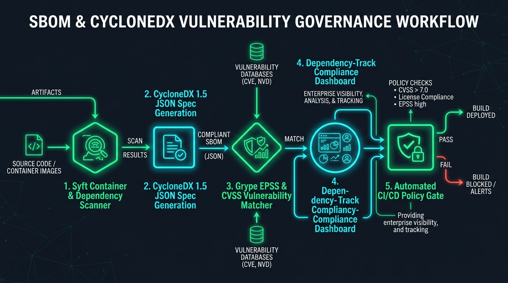

[](https://pradeeptalari.me/projects/)
[](https://pradeeptalari.me/tools/repo-learning/)

# SBOM & CycloneDX Vulnerability Governance Studio

[](https://github.com/Pradeeptalari14/tp-sbom-cyclonedx-governance/actions)
[](LICENSE)
[](https://talaripradeep.info/tools/sbom-cyclonedx-governance/)
[](https://talaripradeep.info/studios/flow/?studio=sbom-cyclonedx-governance)

> **Author:** [Talari Pradeep](https://talaripradeep.info) — Senior SRE & Platform Architect  
> **Interactive Studio Workspace:** [https://talaripradeep.info/tools/sbom-cyclonedx-governance/](https://talaripradeep.info/tools/sbom-cyclonedx-governance/)  
> **Visual Flow Canvas DAG:** [https://talaripradeep.info/studios/flow/?studio=sbom-cyclonedx-governance](https://talaripradeep.info/studios/flow/?studio=sbom-cyclonedx-governance)  
> **Documentation Guide:** [https://talaripradeep.info/tools/sbom-cyclonedx-governance/learn.html](https://talaripradeep.info/tools/sbom-cyclonedx-governance/learn.html)

---

## 1. System Architecture Flow



### Architectural Highlights
Generate CycloneDX and SPDX Software Bill of Materials (SBOM) using Syft, enforce Grype vulnerability gates with EPSS scoring, and verify licensing compliance.

* **Cryptographic Provenance:** Guarantees tamper-proof software supply chain attestation before deployment.
* **Deterministic Policy Gates:** Continuous enforcement against unauthorized container digests, bad dependencies, or untrusted inputs.
* **Zero Static Secrets:** Ephemeral identity validation avoiding long-lived bastion credentials.

---

## 2. Infrastructure & Software Technology Stack

| Category | Technology | Architectural Role |
| :--- | :--- | :--- |
| **SBOM Generation** | `Anchore Syft 1.10+`, `CycloneDX 1.5 JSON`, `SPDX 2.3 Tag-Value` | Enterprise verification & telemetry |
| **Vulnerability Matcher** | `Anchore Grype 0.79+`, `FIRST.org EPSS API v2`, `NIST National Vulnerability DB` | Enterprise verification & telemetry |
| **Governance & Ingestion** | `OWASP Dependency-Track`, `SPDX License Classifier`, `GitHub SARIF Tab` | Enterprise verification & telemetry |

---

## 3. Primary Specification Manifest: `sbom-policy.yaml`

```yaml
apiVersion: governance.cyclonedx.org/v1
kind: SBOMAuditPolicy
metadata:
  name: cyclonedx-governance
spec:
  specVersion: "1.5"
  formats: ["cyclonedx-json", "spdx-json"]
  scanner:
    engine: "syft"
    vulnerabilityMatcher: "grype"
    epssThreshold: 0.05
    maxCvssScore: 7.0
  failOnSeverity: ["CRITICAL", "HIGH"]
```

---

## 4. Quickstart & Local Verification

### A. Clone and Validate
```bash
git clone https://github.com/Pradeeptalari14/tp-sbom-cyclonedx-governance.git
cd tp-sbom-cyclonedx-governance

# Execute SRE validation drill
chmod +x scripts/validate.sh
./scripts/validate.sh
```

### B. Run Implementation Automation
```bash
python3 main.py
```

---

## 5. Kubernetes & Docker Deployment

### Docker Run
```bash
docker build -t tp-sbom-cyclonedx-governance:latest .
docker run --rm tp-sbom-cyclonedx-governance:latest
```

### Kubernetes Admission Policy
```yaml
apiVersion: batch/v1
kind: CronJob
metadata:
  name: continuous-sbom-scanner
spec:
  schedule: "0 2 * * *"
  jobTemplate:
    spec:
      template:
        spec:
          containers:
            - name: syft-scanner
              image: anchore/syft:latest
              args: ["dir:/app", "-o", "cyclonedx-json=/out/sbom.json"]
          restartPolicy: OnFailure
```

---

## 6. SRE Runbook & Operational Verification

* **Verify Signatures & Telemetry:**
  ```bash
  cosign verify --certificate-identity-regexp '.*@github\.com' ghcr.io/pradeep/service:latest
  ```
* **Audit Rekor Transparency Log:**
  ```bash
  rekor-cli search --sha <IMAGE_SHA256_HASH>
  ```

---

## 7. License

Licensed under the [MIT License](LICENSE). Copyright (c) 2026 Talari Pradeep.

---
*Synchronized with [SBOM & CycloneDX Vulnerability Governance Studio Studio](https://pradeeptalari.me/tools/sbom-cyclonedx-governance/) & [Repository Learning DAG](https://pradeeptalari.me/tools/repo-learning/) — [Talari Pradeep Portfolio](https://pradeeptalari.me)*
